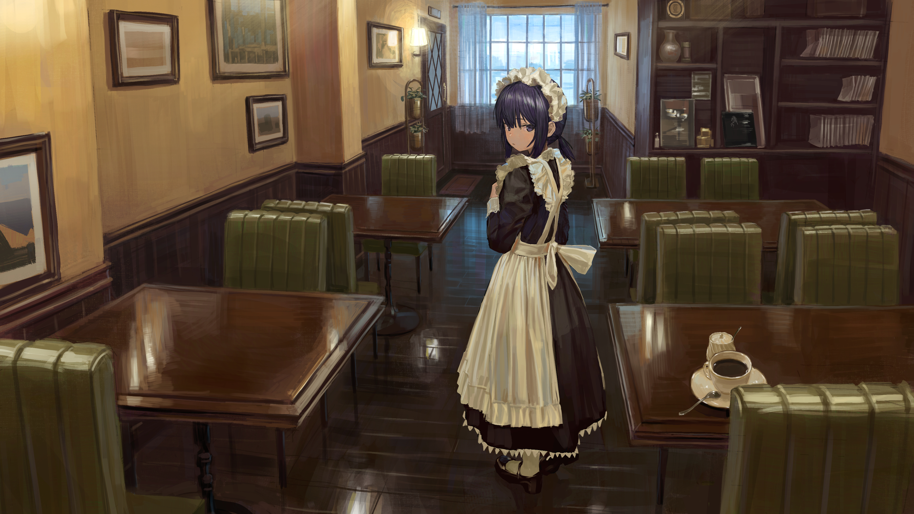
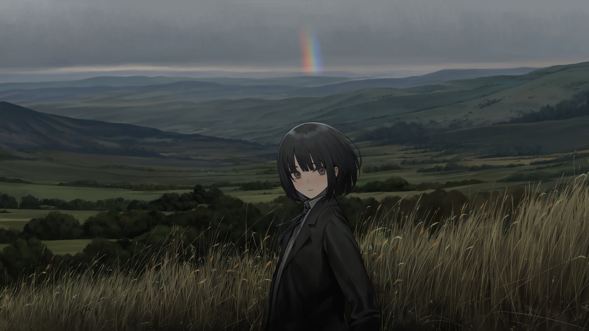

# Wallpapers

Original files preserved from my desktop collection. The installer can link them individually into `~/Pictures/Wallpapers`; it never replaces the whole Pictures directory or changes desktop settings.

| Preview | File | Resolution |
| --- | --- | --- |
|  | `02rz3dw29c2h1_upscaled.jpeg` | 4320 × 2428 |
|  | `nicerocket.png` | 5000 × 3470 |
|  | `wallhaven-9o927x_3840x2160.png` | 3840 × 2160 |
|  | `wallhaven-qrgqyq_3840x2160.png` | 3840 × 2160 |

The original filenames are retained. The two `wallhaven-*` filenames record their source identifiers; creator and license information was not present in the local collection. No authorship or licensing rights to the artwork are claimed. These images are **not covered by this repository's MIT license**.
